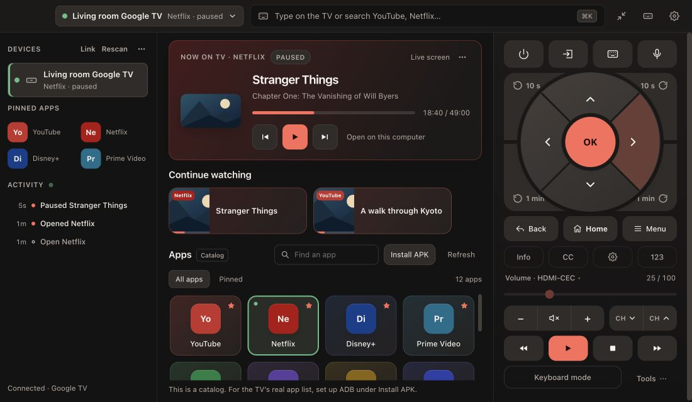
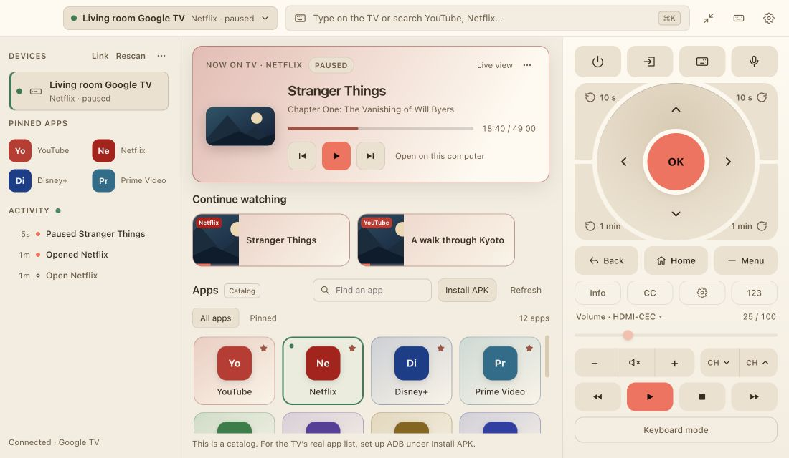
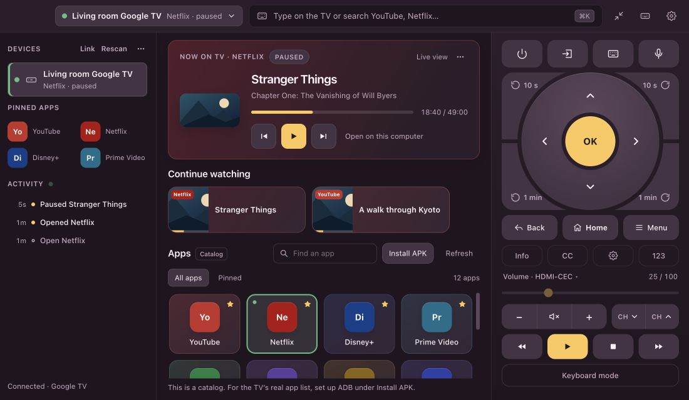

<div align="center">

# TV Controller

### Control your TV from your Mac or Windows desktop.

**Chromecast · Google TV · Samsung · LG webOS · Roku · Android TV**

[Download](https://github.com/thesiyonara/tv-controller/releases/latest) · [Website](https://thesiyonara.github.io/tv-controller/) · [Report an issue](https://github.com/thesiyonara/tv-controller/issues)

Free and open source. No account or subscription.



*Real app screens with sample devices and playback.*

</div>

## Your TV, without leaving your keyboard

- **A full remote.** Large directional wedges, press-and-hold navigation, media controls, volume, input, captions and a number pad where supported.
- **Type and search.** Use your keyboard instead of the TV’s on-screen alphabet. Send text, paste supported media links, or turn on keyboard mode.
- **Apps your way.** Pin favourites and drag them into order in the sidebar, compact remote or app organiser. Assign corner shortcuts to skips, TV controls or favourite apps.
- **One remote for a whole setup.** Link a streaming box and TV: send navigation to Google TV and volume to Samsung, for example.
- **Compact when you need it.** A small remote window, sleep timers and optional global shortcuts.
- **A colour palette that feels like yours.** Cinema, Sand, Plum and Ocean, with light/dark appearance and accent choices.

<table><tr><td width="50%"></td><td width="50%"></td></tr><tr><td align="center">Sand</td><td align="center">Plum</td></tr></table>

## Download

Get installers from the **[latest release](https://github.com/thesiyonara/tv-controller/releases/latest)**.

| Computer | File |
|---|---|
| Mac with Apple Silicon (M-series) | `TV Controller-…-mac-arm64.dmg` |
| Mac with Intel | `TV Controller-…-mac-x64.dmg` |
| Windows 64-bit | `TV Controller-…-win-x64.exe` installer, or the `portable.exe` build |
| Linux | AppImage / DEB when available; experimental and not hardware-tested |

macOS bundles are ad-hoc signed, not Apple-notarized. Windows builds do not have a verified publisher signature. Your OS may require first-launch confirmation. Follow your OS’s normal approval flow; there is no need to disable its security protections.

## Connect your TV

1. Put your computer and TV on the same local network.
2. Open TV Controller and choose the discovered device, or add its IP address.
3. Enter the TV’s pairing code or accept its connection prompt when required.
4. For a streaming box connected to a separate TV, use **Link** to combine their controls.

| Device family | Main controls | Pairing |
|---|---|---|
| Android TV / Google TV | Navigation, keyboard, apps, media keys | Code displayed on TV |
| Chromecast / Google Cast | Playback, seeking, volume, supported media URLs | Local-network discovery |
| Samsung Tizen | Remote keys, apps, typing, volume | Allow prompt on TV |
| LG webOS | Remote keys, apps, typing, volume, TV channel information | Accept prompt on TV |
| Roku | Remote keys, typing, apps, supported TV controls | Network control must be enabled |

Chromecast is a media receiver, not a full directional remote. Availability varies by TV model, software and app. Android remote control and a Google TV + Samsung setup have been used on hardware; several model-specific features remain unverified.

## Playback details

Cast sessions can supply title, artwork, position and duration. Native Netflix, Stremio and other Android TV apps can report titles and playback state through **optional ADB setup**. Use **Tools → Playback** or **Get TV apps** to begin setup. The TV must explicitly allow debugging.

Not every app exposes the same metadata. Artwork and duration may be missing. DRM-protected video cannot appear in screen previews. A failed screen preview does not stop healthy playback reporting; use **Retry screen** to try again.

The 0.8.0 playback fixes are covered by mock-device regressions, including partial Cast updates, stale Netflix/Stremio sessions and reconnects. They still need real-device verification across app and TV versions.

## Private by choice

There is no account, analytics service or cloud relay. TV commands go over your local network. Optional features fetch app icons, artwork, search results and updates; **Local network only** disables internet connections from the app.

Pairings and preferences stay in the app’s local data folder. In **Settings**, choose **Encrypt saved TV pairings**:

- **Off:** a local file restricted to your user account. No Keychain calls for unencrypted pairings. The file is **not encrypted**, so other software running as your account can read it. This is the macOS default.
- **On:** Electron’s OS encryption—macOS Keychain, Windows DPAPI, or an available Linux keyring. Windows enables it by default. macOS may ask for access after an update.

Existing encrypted pairings still require OS access to read or migrate them. Declining access preserves the encrypted copy. A short PIN is not offered as a substitute for encryption.

See the [security model](docs/SECURITY.md) for transport, storage, networking and update details. Never commit your local settings, pairing keys, tokens or diagnostic logs.

## Build from source

Requires Node.js 22 or newer and npm.

```sh
npm ci
npm test
npm start
```

```sh
npm run package:mac    # macOS DMG + ZIP, Apple Silicon and Intel
npm run package:win    # Windows installer + portable app
npm run package:linux  # experimental AppImage + DEB
```

Build macOS packages on macOS and Windows packages on Windows. Output goes into `release/`. If a synced folder adds Finder metadata that prevents macOS signing, use an output directory outside that synced folder:

```sh
npm run package:mac -- --config.directories.output=/tmp/tv-controller-build
```

Core tests use local mock TVs. `npm run stress` also exercises dropped connections and stalled handshakes. UI stress testing requires an Electron display environment.

## Contributing

Bug reports should include your OS, TV model, app version and what you expected to happen. **Remove device addresses, personal names, tokens, pairing codes and private media details before attaching screenshots or logs.**

This public repository starts with the reviewed 0.8.0 source. It does not include private development history or user settings.

## License

[MIT](LICENSE). Independent software; not affiliated with Google, Samsung, LG, Roku or streaming services. Product names belong to their respective owners.
